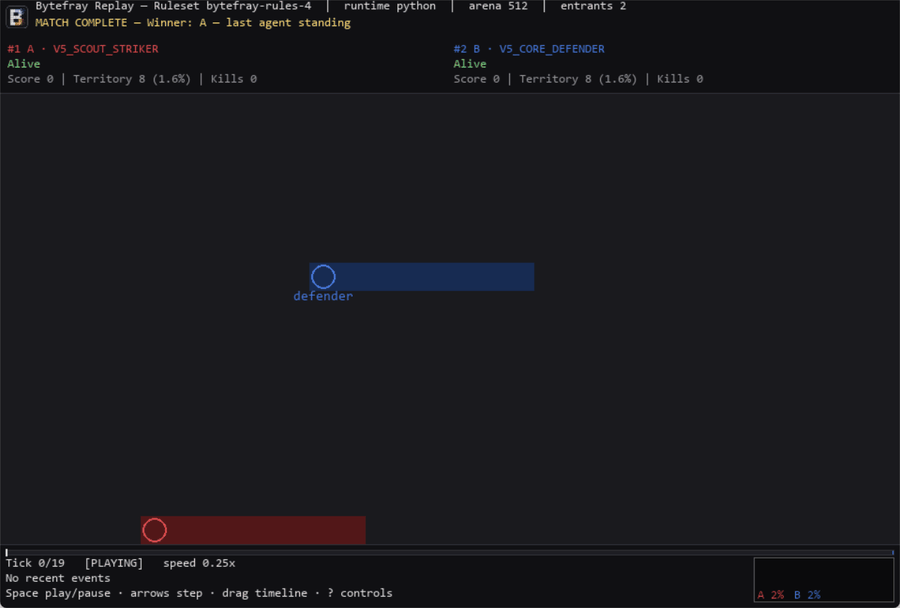
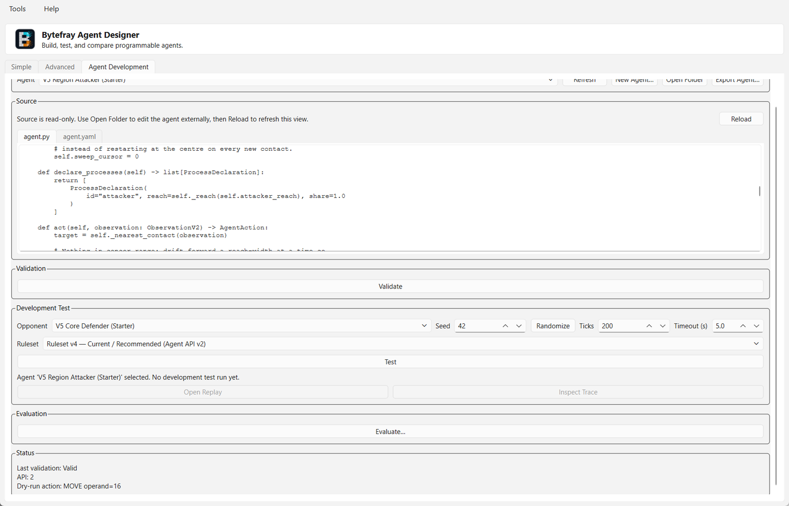
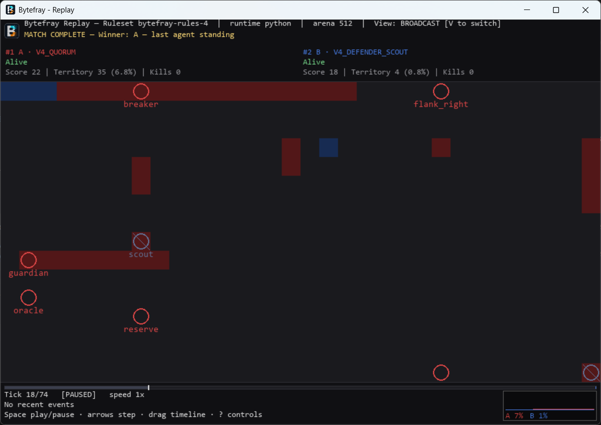

# Bytefray

<p align="center">
  
</p>

Bytefray is a deterministic shared-memory programming game where Python agents compete for control of a circular arena.

You write the agents: they maneuver, inspect, and rewrite memory while defending their own core. Matches between Python agents can be replayed and analyzed, and deterministic execution makes the same configuration reproducible.

[](pyproject.toml)
[](LICENSE)

## Bytefray 6 Alpha

**Bytefray 6.0.0-alpha.1** is an Alpha preview for Windows. Its one Ruleset is
**Active Sensing (Alpha)** (`bytefray-rules-6-alpha1`): an agent finds its
opponent only by spending actions on `SENSE`, and the answer arrives later and
anonymously. It is experimental; matches are short, and defence has not yet
been shown to change outcomes.

| Release | What it is |
| --- | --- |
| **Bytefray 6.0.0-alpha.1** | This preview (Python package `6.0.0a1`, tag `v6.0.0-alpha.1`). Active Sensing only. Installs for your Windows account beside earlier releases and migrates nothing from them. See the [release notes](docs/releases/BYTEFRAY_6_0_0_ALPHA_1_RELEASE_NOTES.md). |
| **Bytefray 5.1.0-alpha.1** | The previous preview and the last release that runs the **Classic** Ruleset (`bytefray-rules-4`). Keep it installed if you want Classic: 6 Alpha installs beside it and leaves it untouched. |
| **Bytefray 5.0.0** | The latest stable release (Classic). See the [stable `main` branch](https://github.com/libertaine/Bytefray/tree/main). |
| **Bytefray Spectator** | A separate Godot viewer with its own versions. 6 Alpha bundles Spectator `0.1.0-alpha.1`, the same build as 5.1 Alpha. |

What 6 Alpha changes from 5.1 Alpha: Classic and its ten agents are retired
([decision record](docs/releases/CLASSIC_RULESET_RETIREMENT.md)); a new
**practice opponent**, `v6_practice_hunter`, plays to win and is the default
opponent for `bytefray agents test` and Designer; new matches use a 512-cell
arena by default; and `bytefray agents validate` accepts `SENSE` without
`--ruleset`. Component versions are listed in the
[6.0.0-alpha.1 compatibility record](docs/releases/BYTEFRAY_6_0_0_ALPHA_1_COMPATIBILITY.md).

How this gameplay came about, and the research behind it, is in the
[research history](docs/research/BYTEFRAY_RESEARCH_HISTORY.md).

<p align="center">
  
</p>
<p align="center"><em>A deterministic Bytefray match replayed in the Pygame viewer.</em></p>

**Design → Battle → Replay → Analyze**

With Bytefray, you can:

* **Write Python agents** with structured APIs and configurable parameters.
* **Run deterministic matches and tournaments** from the command line or Agent Designer.
* **Replay and analyze results** with canonical artifacts and interactive tooling.

## Downloads

**Preview: [Bytefray 6.0.0-alpha.1](https://github.com/libertaine/Bytefray/releases/tag/v6.0.0-alpha.1).**
On Windows, download `Bytefray-6.0.0-alpha.1-Windows-x64-Setup.exe`. It needs
no administrator rights, Python or Godot, and includes Agent Designer, the
command line, the replay viewer and Bytefray Spectator. The Python wheel
`bytefray-6.0.0a1-py3-none-any.whl` is on the same release page. Bytefray is
not published on PyPI.

**Stable: [Bytefray 5.0.0](https://github.com/libertaine/Bytefray/releases/tag/v5.0.0)** (Classic) ·
**Classic preview: [Bytefray 5.1.0-alpha.1](https://github.com/libertaine/Bytefray/releases/tag/v5.1.0-alpha.1)** ·
[All releases](https://github.com/libertaine/Bytefray/releases)

## Build agents your way

Use the PySide6 Agent Designer to create agents from templates, configure parameters, inspect source, and validate and test agents. You can also edit Python and YAML in your own editor and use the CLI for matches and automation.

<p align="center">
  
</p>

---

## Quick Start

### 1. Install

**Windows:** run `Bytefray-6.0.0-alpha.1-Windows-x64-Setup.exe` (see
**Downloads**), then open **Bytefray Agent Designer (6 Alpha)** from the Start
Menu. The installer is not code-signed, so Windows SmartScreen will warn you
first; [INSTALL.md](INSTALL.md) explains what it installs and where. To use the
command line from the installed copy, run `bytefray.exe` in
`%LOCALAPPDATA%\Programs\Bytefray 6 Alpha\bin\bytefray`.

**Python wheel (any platform, Python 3.11–3.14):**

```bash
python -m venv .venv
# Windows PowerShell: .\.venv\Scripts\Activate.ps1
# Linux (bash/sh):    source .venv/bin/activate
python -m pip install "bytefray-6.0.0a1-py3-none-any.whl[replay,designer]"
```

For local repository development: `python -m pip install -e ".[dev,replay,designer]"`.
Linux runs headless without GUI libraries ([docs/LINUX_INSTALL.md](docs/LINUX_INSTALL.md));
macOS is not supported.

### 2. Run a match

The bundled agents are three **teaching agents** (`v6_window_scout`,
`v6_watchful_keeper`, `v6_roaming_reacquirer`), each showing one Active
Sensing idea, and one **practice opponent**, `v6_practice_hunter`, which
searches with `SENSE`, takes over the cores it finds and repairs its own. The
teaching agents do not fight each other, so play them against the practice
opponent:

```bash
# List the bundled agents
bytefray agents

# Window Scout against the practice opponent, with a replay and a trace
bytefray run --a-type v6_window_scout --b-type v6_practice_hunter --seed 17 --ticks 200 --replay runs/demo/replay.jsonl --trace runs/demo/trace.jsonl
```

The last line prints the winner, the Ruleset and the arena (512 cells unless
you pass `--arena`). In this match Window Scout senses B at tick 1 and writes
one cell of B's core, which B's keeper reads and rewrites at ticks 5 and 6.
B's hunter senses A at tick 4, then reads cells A has written along its path
and takes each over with a band of writes. It reaches A's own core at tick 47,
and A is eliminated at tick 50.

### 3. Inspect the outcome

```bash
# Text playback in the terminal
bytefray replay --replay runs/demo/replay.jsonl --renderer headless

# A Spectator presentation of the match (open it with Bytefray Spectator)
bytefray spectator export --source runs/demo --out runs/demo-spectator

# Or the Pygame viewer (needs the 'replay' extra)
bytefray replay --replay runs/demo/replay.jsonl --renderer pygame
```

In Agent Designer, **Run Match** and then **View Last Match** do the same and
open the bundled Spectator.

### 4. Write, validate and test your own agent

```bash
bytefray agents create my_agent        # from the Agent API v2 template
bytefray agents validate my_agent      # one lifecycle dry run (no --ruleset needed)
bytefray agents test my_agent          # a short match against the practice opponent
```

Edit `agents/my_agent/agent.py` in your data folder, then validate and test
again. [Writing an Agent](#writing-an-agent) and
[docs/AGENT_AUTHORING.md](docs/AGENT_AUTHORING.md) explain the API.

---

## Technical Snapshot

This snapshot describes the shared engine mechanics that
`bytefray-rules-6-alpha1` builds on; its sensing differences are described above.

| Dimension | Specification |
|---|---|
| **Runtime** | Python 3.11–3.14 (CPython; qualified on Windows AMD64 and Linux x86_64) |
| **Dependencies** | PyYAML for core engine; optional `pygame-ce` (replays) and `PySide6` (designer) |
| **Arena Model** | Circular array of discrete memory cells (default 4096); 1-byte value (`0..255`) + last-writer ownership |
| **Simulation** | Discrete-tick deterministic engine; chunked quota scheduling (`K = 2`, `Q = 8`) |
| **Ruleset** | `bytefray-rules-6-alpha1`, Active Sensing (Alpha): spatial multi-process, seed-derived core placement, round-robin process selection, paid SENSE in place of passive enemy visibility |
| **Agent API** | Agent API v2 (`reset`, `declare_processes`, `act`) |
| **Action Vocabulary** | `READ` (absolute address), `WRITE` (absolute address), `MOVE` (relative delta `[-64, 64]`), `SENSE` (scan center address) |
| **Elimination Condition** | Core capture: an entrant is eliminated when it owns 0 cells of its 8-cell core at tick end |
| **Artifact Formats** | `battle2.result` (schema v2 native JSON; v1 historical, including retired Redcode/pMARS records), `battle2.replay` (schema v4 JSONL) |
| **Execution Model** | Local trusted Python execution; worker subprocesses with per-call timeouts for hang containment |
| **Tooling** | Headless CLI, interactive Pygame replay visualizer, PySide6 visual Agent Designer |

---

## How Bytefray Works

This overview describes the mechanics Active Sensing shares with the retired
Classic Ruleset. Where they differ -- passive enemy visibility and the SENSE
action -- see [V6 Alpha 1](#v6-alpha-1-decisions-from-delivered-information) above.

### Arena and Memory Ownership
The arena is a circular array of discrete memory cells (default 4096 cells, wrapping at `arena_size`). Each cell stores an 8-bit integer value (`0..255`) and the identity of the entrant that wrote to it most recently. Unwritten cells have no owner.

### Cores and Elimination
Every entrant is assigned a contiguous 8-cell core (`CORE_SIZE = 8`). Core locations are derived deterministically from the match seed with a guaranteed minimum circular separation (64 cells) between entrants.

* **Victory Condition**: An entrant is eliminated when it owns **zero of the eight cells** of its assigned core.
* Elimination checks occur once per tick, after all actions for that tick have executed. Holding even a single core cell keeps the entrant alive.
* If multiple entrants remain alive when the tick limit is reached, winner resolution evaluates accumulated scores based on survival time, core kills, and territorial ownership.

### Spatial Multi-Process Execution
Entrants act through one or more *processes*. Each process has:
* An **anchor**: Its current address in the circular arena. All processes begin co-located at their entrant's core base.
* A **reach**: A circular radius around the anchor within which the process can read and write.
* A **quota share**: The proportion of the entrant's per-tick action budget allocated to this process.

Declaring additional processes provides spatial positioning and specialized roles, not additional actions: every entrant shares a fixed budget of `Q = 8` actions per tick regardless of process count.

### Fundamental Game Loop

Each simulation tick resolves through five deterministic phases:

```
[Interleaved Quota Scheduling]
           │
           ▼
[Round-Robin Process Selection]
           │
           ▼
 [Observation Generation] ──► [Agent Decision: act()]
           │
           ▼
[Deterministic Action Resolution & Disruption]
           │
           ▼
[Core Capture Check, Scoring, & Replay Snapshot]
```

1. **Entrant Scheduling**: Entrants take turns in chunked action slots (`K = 2` actions per slice) rotating starting seat order across ticks to eliminate first-player bias.
2. **Process Selection**: Within an entrant's turn, action slots rotate across its eligible processes via round-robin selection. If a process was disrupted earlier in the tick, its remaining share redistributes evenly among remaining eligible processes.
3. **Observation**: The engine supplies the active process with an immutable `ObservationV2`. Enemy positions are never supplied passively; a process learns of anonymous contacts only through its own earlier SENSE receipts. Opponent identities, core locations, process configurations, and strategy states are never revealed.
4. **Action Execution**: The process returns one of four actions:
   * **`WRITE(address, value)`**: Writes `value & 0xFF` to an absolute address within the process's reach and claims ownership. If the address matches an enemy process's anchor, all enemy processes on that cell are disrupted for the remainder of the tick (`D = 1`).
   * **`READ(address)`**: Reads the byte value and last-writer entrant ID at an absolute address within reach, reported in the process's subsequent observation.
   * **`MOVE(delta)`**: Adjusts the process's anchor by a signed relative displacement, clamped to `[-64, 64]` and wrapped circularly.
   * **`SENSE(address)`**: Spends the action scanning a ±27-cell window centered within reach; the sampled anonymous anchors arrive in the process's next eligible observation.
   * *Rejection*: Actions targeting addresses beyond a process's declared reach are discarded; the action slot is consumed without effect.
5. **Tick Resolution & Telemetry**: Core ownership is audited for eliminations. Territory and survival scores accrue, and state diffs are appended to the canonical `replay.jsonl` stream.

---

## Writing an Agent

### Create Your First Agent

An Agent API v2 agent implements a factory returning an object with three methods: `reset`, `declare_processes`, and `act`.

Scaffold a new agent using the CLI:

```bash
bytefray agents create my_agent --api-version 2 --template blank
```

This writes an `agent.yaml` manifest and an `agent.py` starter into your writable agents catalog. Edit those files to define the agent; the generated Python entry point begins:

```python
"""Starting point for a Bytefray Agent API v2 process agent."""

from battle_engine.agent_api import (
    ActionKindV2,
    AgentAction,
    MatchContextV2,
    ObservationV2,
    ProcessDeclaration,
)


class Agent:
    def reset(self, context: MatchContextV2) -> None:
        """Called once before tick 0. Store match context and seeded RNG."""
        self.rng = context.rng
        self.signature = 0xA5

    def declare_processes(self) -> list[ProcessDeclaration]:
        """Declare processes and divide your per-tick action quota (shares must sum to 1.0)."""
        return [ProcessDeclaration(id="main", reach=1, share=1.0)]

    def act(self, observation: ObservationV2) -> AgentAction:
        """Called for each allocated action slot. Returns READ, WRITE, or MOVE."""
        return AgentAction(
            kind=ActionKindV2.WRITE,
            operand=observation.self_anchor,
            value=self.signature,
        )


def create_agent() -> Agent:
    return Agent()
```

### Run Your Custom Agent

Execute a match with your new agent against any reference opponent:

```bash
bytefray run --a-type my_agent --b-type v6_watchful_keeper --seed 42 --ticks 200
```

### Validate and Test

Use Agent Lab commands to verify lifecycle compliance and test against opponents with hang containment:

```bash
# Dry-run validation (verifies factory, reset, process declaration, and one act call)
bytefray agents validate my_agent

# Run a supervised development match with timeout protection
bytefray agents test my_agent --opponent v6_watchful_keeper
```

The PySide6 Agent Designer provides a graphical workflow for creating, inspecting, validating, and development-testing agents while retaining direct access to the Python source. Agents remain plain Python, and every step above works from the CLI without it.

### Agent API v2 Interface

Agents target the `AgentV2` protocol defined in `battle_engine.agent_api`:

```python
class AgentV2(Protocol):
    def reset(self, context: MatchContextV2) -> None: ...
    def declare_processes(self) -> list[ProcessDeclaration]: ...
    def act(self, observation: ObservationV2) -> AgentAction: ...
```

* **`reset(context: MatchContextV2)`**: Runs once before tick 0. Provides `context.arena_size`, `context.tick_limit`, `context.agent_id` (slot `"A"`, `"B"`, etc.), `context.parameters`, and `context.rng`.
* **`declare_processes() -> list[ProcessDeclaration]`**: Runs once after `reset`. Returns a list of `ProcessDeclaration(id="...", reach=..., share=...)`. Shares must be non-negative and sum to `1.0`.
* **`act(observation: ObservationV2) -> AgentAction`**: Invoked for each action allocated to the acting process. Returns an `AgentAction(kind=ActionKindV2.*, operand=..., value=...)`.

### Observation Model

Under Active Sensing the passive perception field below is always empty;
contacts arrive as explicit SENSE receipts (`previous_sense_anchors`) as
described above.

Every call to `act` receives an immutable `ObservationV2`:

| Category | Attributes | Description |
|---|---|---|
| **Identity & Position** | `self_process_id`, `self_anchor`, `self_reach` | ID, current arena address, and reach radius of the acting process |
| **Friendly Core** | `own_core_base`, `own_core_size` | Starting address and cell length (`8`) of your own core |
| **Perception** | `visible_enemy_anchor_addresses`, `previous_sense_anchors` | Passive enemy anchors (always empty under Active Sensing); sorted anonymous anchors sampled by this process's previous SENSE |
| **Feedback** | `previous_action_applied`, `previous_read_value`, `previous_read_owner` | Outcome and read payload from this process's preceding action |
| **Timing** | `current_tick`, `last_callback_tick`, `previous_action_tick` | Tick indices for temporal tracking and disruption inference |

### Parameters and Presets

Agents can declare typed parameter schemas in `agent.yaml`. Values are validated at match configuration time and passed to `reset` via `context.parameters`:

```yaml
kind: python
api_version: 2
entrypoint: agent.py:create_agent
version: "1.0.0"

parameters:
  attacker_reach:
    type: int
    default: 16
    min: 4
    max: 64

presets:
  far_sighted:
    attacker_reach: 32
```

Parameters follow precedence: `schema defaults < preset < CLI/GUI overrides`. Overrides are passed at the command line via `--a-preset` and `--a-param`:

```bash
bytefray run --a-type v6_window_scout --b-type v6_watchful_keeper --a-preset standard --a-param search_interval=6
```

See [docs/AGENT_API_V2.md](docs/AGENT_API_V2.md) for the complete authoring specification and the [M1-2 implementation record](docs/v6/V6_ALPHA_M1_2_IMPLEMENTATION_RECORD_01.md) for the Window Scout teaching starter.

---

## Determinism and Reproducibility

A match is driven by an explicit seed and deterministic engine rules. Agents that use Bytefray's provided RNG and obey the deterministic-agent contract can reproduce simulations for testing, replay, tournament evaluation, and automated experimentation.

### Concrete Guarantees and Limits

* **Same-Environment Byte-Identical Artifacts**: Given the same match seed, ruleset identity, entrant configurations, parameters, and arena dimensions, repeated executions on the same environment produce identical match outcomes, identical event timelines, and byte-identical `replay.jsonl` and `result.json` records.
* **Cross-Platform Semantic Equivalence**: Simulation state transitions, scheduling, seeded core placement (`seeded_seat_starts`), and winner resolution rely on discrete integer arithmetic. Continuous integration validates deterministic regression vectors across Windows AMD64 and Linux x86_64, and across Python 3.11 through 3.14.
* **Deterministic Trace Identity**: Diagnostic traces (`trace.jsonl`) generated during supervised test runs capture identical decision sequences across runs with matching seeds.

### The Deterministic Agent Contract

Bytefray's engine guarantees determinism **if and only if** agent implementations adhere to the following constraints:

1. **Use `context.rng`**: Use only the seeded `random.Random` instance provided in `MatchContextV2`. Never import or call unseeded global generators (`random.random()`, `numpy.random`).
2. **No Wall-Clock Time**: Do not branch on `time.time()`, `time.perf_counter()`, or datetime values.
3. **No External I/O**: Do not perform filesystem access, network requests, subprocess execution, or IPC during `reset`, `declare_processes`, or `act`.
4. **No Address/Memory Hashing**: Avoid iterating over sets or dictionaries keyed by object memory addresses (`id()`) or types whose hash randomized across Python processes (`PYTHONHASHSEED`).
5. **No Shared Mutable State**: Do not store state in class variables or module-level globals that persist across multiple match invocations.

Bytefray does not enforce sandboxing or runtime restrictions to prevent nondeterministic code; agents that violate these boundaries will produce diverging simulations that cannot be reproduced.

---

## Replays and Tooling

Bytefray includes a modular tool suite separating headless simulation from presentation:

### 1. Command-Line Interface (`bytefray`)
* `bytefray run`: Execute native Bytefray matches.
* `bytefray replay`: Play back recorded `.jsonl` replays via headless terminal or Pygame.
* `bytefray tournament`: Run or resume headless round-robin tournaments across rosters.
* `bytefray design`: Launch the PySide6 visual Agent Designer.
* `bytefray agents`: Comprehensive agent lifecycle tools:
  * `create`: Scaffold blank or annotated starter templates (`--api-version 2`).
  * `validate`: Dry-run agent lifecycle with timeout protection.
  * `test`: Execute short development matches against reference opponents.
  * `inspect`: Inspect observation and action decisions from `trace.jsonl`.
  * `diverge`: Compare two traces to identify the exact tick where decisions differed.
  * `evaluate`: Run pairwise or group evaluation matrices across seeds.
* `bytefray spectator`: Verify a completed Active Sensing (Alpha) match and `export` it for Bytefray Spectator (development branch; see [docs/specs/spectator_export.md](docs/specs/spectator_export.md)).

### 2. Pygame Replay Viewer
Launched via `bytefray replay --replay <path> --renderer pygame` or `bytefray-replay-viewer`. Features:
* Broadcast and perspective viewing modes.
* Visual process anchors, reach perimeters, and disruption indicators.
* Memory ownership overlays with territory tracking bars.
* Interactive playback controls: scrub timeline, step tick-by-tick, adjust speed.

<p align="center">
  
</p>
<p align="center"><em>Broadcast-mode view of the replay viewer, showing process anchors, reach zones, memory ownership, and the playback timeline.</em></p>

### 3. PySide6 Agent Designer
Launched via `bytefray design` or `bytefray-agent-designer`. Features:
* Match setup with agent selection, seed controls, and ruleset pickers.
* Dynamic parameter controls generated from agent YAML schemas.
* Built-in code inspection, validation, test launcher, and replay browser.
* **View Last Match** in Bytefray Spectator for supported Active Sensing (Alpha) matches, when
  Spectator is installed or configured (development branch; Pygame otherwise).
* **Replay History** (**History → Replay History…**): a searchable, filterable
  browser over every completed match Bytefray has written, including matches
  produced before the current result schema. Selecting a match with an
  available replay lets you **Open Replay** (launches the same Replay Viewer
  used everywhere else in Bytefray) or **Copy Seed** (copies the match's
  integer seed to the clipboard -- reproducing the exact match also requires
  the same agents, ruleset, parameters, and configuration, which History does
  not attempt to restore). Re-running a match from History is not implemented.
  Filter by entrant, ruleset, outcome, date, seed, source, or replay availability.
  Dates marked **≈** are approximate legacy dates; missing or invalid replays
  leave their result history browsable. **Refresh** checks for new matches in
  the background while browsing and replay checks remain available. History's
  cache is rebuildable from saved artifacts; deleting it does not delete matches.

---

## Bytefray vs. Core War

Bytefray takes inspiration from Core War's shared-memory competitive programming model but is not a Redcode implementation or compatibility layer.

| Dimension | Core War (ICWS'94 / Redcode) | Bytefray (Ruleset v4 / Agent API v2) |
|---|---|---|
| **Warrior Code** | Redcode assembly text executed instruction-by-instruction | Standard Python classes implementing structured lifecycle methods (`reset`, `declare_processes`, `act`) |
| **Arena Memory** | Circular array of Redcode instructions (`opcode`, addressing modes, A/B fields) | Circular array of discrete memory cells storing byte values (`0..255`) and last-writer ownership |
| **Execution Model** | Instruction pointer step; warriors mutate memory into executable code or bombs | Discrete ticks; per-entrant action quotas (`Q = 8`) distributed to processes via round-robin scheduling |
| **Multi-Process Model** | Dynamic process splitting via the `SPL` instruction | Process declarations (`ProcessDeclaration`); fixed per-entrant quota shared across all processes |
| **Combat & Victory** | Elimination occurs when a process thread executes an illegal instruction (e.g. `DAT`) | Core defense: an entrant is eliminated when it owns zero cells of its 8-cell arena core |
| **Interference Mechanic** | Corrupting opponent instruction code in memory | Disruptive writes: a `WRITE` hitting an enemy process anchor disrupts that process for the tick (`D = 1`) |
| **Sensing & Perception** | Warriors cannot inspect memory without reading cells via `CMP` / `SLT` | Structured spatial observation (`ObservationV2`) providing anchor, reach, core base, and visible enemy anchors |
| **Randomness & Placement** | Starting placement randomized in core; no runtime RNG | Seed-derived core placement (`seeded_seat_starts`); per-entrant seeded RNG (`context.rng`) |
| **Tooling & Ecosystem** | Vintage terminal simulators and pMARS binaries | Headless CLI, canonical JSON/JSONL replays, interactive Pygame visualizer, and PySide6 graphical designer |

---

## Execution and Trust Model

Bytefray's execution architecture distinguishes between **development reliability containment** and **security sandboxing**.

### Local Trusted Code Model
Agents are trusted local Python code executed through Bytefray's gameplay interface. Bytefray is designed for local experimentation and evaluation, not as a hardened sandbox for untrusted hostile code. Agent modules are imported dynamically and execute with the full OS permissions of the running user.

> **Security Boundary**: Bytefray does **not** provide a hardened security sandbox against hostile or untrusted code. Never execute unreviewed third-party agents from untrusted sources.

### Hang and Timeout Containment
To protect development workflows, test harnesses, and automated tournaments from broken agent code, Bytefray provides isolated process supervision:

* **Supervised Worker Subprocesses**: `bytefray agents test`, `bytefray agents validate`, and parallel evaluation cells execute Python entrants inside dedicated worker subprocesses (`AgentWorkerHandle`).
* **IPC Isolation**: Workers communicate via newline-delimited JSON over standard input and output pipes. Standard output is redirected to standard error before agent execution to prevent `print()` statements from corrupting protocol streams. Standard input is closed to prevent interactive `input()` calls from blocking.
* **Uniform Per-Call Timeouts**: Supervised calls enforce an explicit deadline (default `5.0s`, configurable via `--timeout`). If an agent blocks during load, `reset()`, or an individual `act()` call, the worker process is terminated unconditionally.
* **Actionable Diagnostics**: Timeouts and uncaught exceptions produce structured diagnostic events (`agent_action_timeout`, `agent_worker_exited`, etc.) and forfeit the match without hanging the caller.
* **Direct Execution Performance**: Standard `bytefray run` matches execute in-process by default to eliminate IPC overhead (~120 ms for a 200-tick match).

---

## Engineering Standards

Bytefray's codebase emphasizes strict reproducibility, version isolation, and architectural boundaries:

* **Explicit Seeds & Discrete Arithmetic**: All simulation logic (scheduling, movement, placement, action resolution) uses discrete integer math and explicit seeds; floating-point simulation drift is eliminated.
* **Separation of Simulation & Visualization**: The engine (`battle_engine`) executes entirely headless without GUI dependencies. Presentation tools (`battle_client`, Pygame viewer, PySide6 Designer) consume decoupled event and replay streams.
* **Typed Protocols & Immutable Data**: Agent interactions use strict dataclasses and typed protocols (`AgentV2`, `MatchContextV2`, `ObservationV2`, `AgentAction`). Observations and match contexts are immutable or read-only proxies.
* **Independent Compatibility Axes**: Release versions, Agent API versions, Ruleset identities, and artifact wire schemas are decoupled and versioned independently (see [docs/COMPATIBILITY.md](docs/COMPATIBILITY.md)). A ruleset change does not force an API or schema bump.
* **Deterministic Artifact Hashing**: Match identities (`match_id`, `result_id`, `replay_id`) derive deterministically from canonical SHA-256 hashes of agent source, configuration, and ruleset identity—independent of absolute checkout paths or filesystem timestamps.
* **Multi-Platform CI Qualification**: Continuous integration qualifies headless execution and determinism regression suites on Linux using the [tiered Python 3.11–3.14 matrix](docs/CI.md). Windows CI retains process-containment, worker-cleanup and NTFS-junction tests on Python 3.13, plus release-style EXE builds; it does not run the full suite on every interpreter.

---

## Rulesets and Compatibility

Bytefray maintains independent, versioned compatibility axes across releases, rulesets, and schemas (see [docs/COMPATIBILITY.md](docs/COMPATIBILITY.md)).

Bytefray 5.0.0 used permanent Ruleset 4 and introduced no Ruleset 5. Bytefray
5.1.0-alpha.1 offered `bytefray-rules-4` (Classic) alongside experimental
`bytefray-rules-6-alpha1` (Active Sensing). After that preview, Classic was
retired: this development line runs Active Sensing only. Ruleset identities
remain independent of the application version.

### Active Gameplay Ruleset: `bytefray-rules-6-alpha1`
Active Sensing (Alpha) is the only executable Ruleset. An omitted `--ruleset`
flag resolves to it, and the Designer runs it without a Ruleset control. It defines:
* Spatial multi-process execution with round-robin process selection.
* Seed-derived core placement with minimum 64-cell circular separation.
* Fixed ruleset constants: `CORE_SIZE = 8`, `Q = 8` actions/tick, `D = 1` disruption duration, move clamp `[-64, 64]`.
* No passive enemy visibility; a paid `SENSE` action with delayed, anonymous delivery. Its inherited detection radius of 32 is inert for perception but still requires arenas larger than 64 cells.

### Historical Rulesets
On this branch, `bytefray-rules-1`, `bytefray-rules-2`, Agent API v1 and VM/blob
match execution are retired, as are `bytefray-rules-4-alpha1`,
`bytefray-rules-4-alpha2` and, after 5.1.0-alpha.1, `bytefray-rules-4` (Classic).
Requests naming a retired Ruleset are rejected with a message saying so; nothing
is silently remapped to Active Sensing. Classic's starter agents (`v4_*`, `v5_*`)
are no longer installed or packaged. Historical artifacts remain readable, indexable and
replayable; exact historical re-execution requires the matching released version,
including `v5.0.0` for the earlier executable surfaces and `v5.1.0-alpha.1`
for Classic. See the [Classic retirement record](docs/releases/CLASSIC_RULESET_RETIREMENT.md), the
[retirement policy](docs/COMPATIBILITY.md)
and [runtime retirement record](docs/research/v6/V6_PHASE2B12_SCOPE_C_RUNTIME_RETIREMENT.md).

Redcode/pMARS execution is also retired here and historically used a separate
backend. Historical tournament/group-evaluation
descriptions in release documents do not restore those retired execution modes.

### Scope Discipline
Mechanics such as fixed process rosters and circular core sizes are ruleset-specific gameplay specifications (`RulesetPolicy`), not immutable project-wide engine constraints.

---

## Project Status and Research

### Current Baseline and Release
* **Gameplay on this line**: Active Sensing (Alpha) (`bytefray-rules-6-alpha1`) is the only supported Ruleset. Classic (`bytefray-rules-4`) remains the gameplay of the published 5.0.0 and 5.1.0-alpha.1 releases.
* **Current Release**: The current stable release is **Bytefray 5.0.0** (`5.0.0`). Bytefray 5 built on the `bytefray-rules-4` gameplay foundation and introduced:
  * Four educational starter agents teaching core defense, area denial, and multi-process coordination (`v5_region_attacker`, `v5_scout_striker`, `v5_core_defender`, `v5_dual_team`); they are Classic agents and are not installed by this development line.
  * Typed parameter schemas and presets in `agent.yaml` with dynamic GUI controls.
  * Enhanced authoring and validation tooling in `bytefray agents`.
  * Comprehensive Replay History discovery and viewer integration.
  * Complete Tournament UX with match replay inspection and tournament history.
  * Standard OS-level accessibility support across Designer workflows.

### Future Gameplay Research
The implemented sensing milestone and M2 teaching work are described
above. Future research into adaptation, action allocation, spatial commitment
and combat timing remains separate from stable release promises. E9 execution
remains locked; no new experiment or competitive-balance conclusion follows
from potential 5.1 positioning.

---

## Documentation

* **Agent Authoring**:
  * [Agent API v2 Reference](docs/AGENT_API_V2.md) — Authoritative Agent API v2 specification.
  * [V5 Starter Agents Guide](docs/V5_STARTER_AGENTS.md) — Historical Classic strategies (agents not installed on this line).
  * [Authoring Workflow](docs/AGENT_AUTHORING.md) — Step-by-step agent creation and validation.
  * [Agent Lab Guide](docs/AGENT_LAB.md) — Tracing, debugging, divergence analysis, and timeouts.
* **Rules and Mechanics**:
  * [Ruleset v4 Specification](docs/RULES_V4.md) — Retired Classic (`bytefray-rules-4`) rules; the shared mechanics Active Sensing builds on.
  * [Classic retirement record](docs/releases/CLASSIC_RULESET_RETIREMENT.md) — What was removed after 5.1.0-alpha.1 and how to recover it.
  * [Historical Ruleset v1](docs/RULES.md) & [Ruleset v2](docs/RULES_V2.md) — Historical gameplay references.
  * [Compatibility Policy](docs/COMPATIBILITY.md) — Ruleset, schema, and API versioning contracts.
* **Systems and Schemas**:
  * [Result Schema](docs/RESULT_SCHEMA.md) — Canonical `battle2.result` JSON model.
  * [Replay Schema](docs/REPLAY_SCHEMA.md) — Canonical `battle2.replay` JSONL model.
  * [Tournament Service](docs/TOURNAMENTS.md) — Headless round-robin tournament execution.
  * [Architecture Overview](ARCHITECTURE.md) — Package boundaries and dependency direction.
* **Installation and Environment**:
  * [Installation Guide](INSTALL.md) — General installation instructions.
  * [Linux Installation](docs/LINUX_INSTALL.md) — Headless Linux and WSL2 setup.
  * [Windows Development Notes](docs/WINDOWS_DEV_NOTES.md) — Windows environment notes and PyInstaller builds.

---

## Development and Testing

Bytefray requires Python 3.11–3.14. Clone the repository and install development dependencies in a virtual environment:

```bash
python -m venv .venv
# Activate virtual environment
python -m pip install -e ".[dev,replay,designer]"

# Run the test suite (excludes GUI display-backed tests)
python -m pytest

# Run linter
ruff check .

# Run static type checkers
mypy engine/src/battle_engine
mypy client/src/battle_client
```

See [CONTRIBUTING.md](CONTRIBUTING.md) and [AGENTS.md](AGENTS.md) for contribution guidelines and architectural discipline.

---

## Contributing

Contributions and issues are welcome on [GitHub](https://github.com/libertaine/Bytefray).

* Follow the development guidelines in [AGENTS.md](AGENTS.md) and [CONTRIBUTING.md](CONTRIBUTING.md).
* Report security vulnerabilities privately according to [SECURITY.md](SECURITY.md).

---

## License and Support

Bytefray is open-source software licensed under the [MIT License](LICENSE).

* **Support**: If Bytefray is useful for your work or research, you can support ongoing development via [PayPal](https://www.paypal.com/donate/?hosted_button_id=DRJD388WT8DAL). Contributions are entirely optional.
